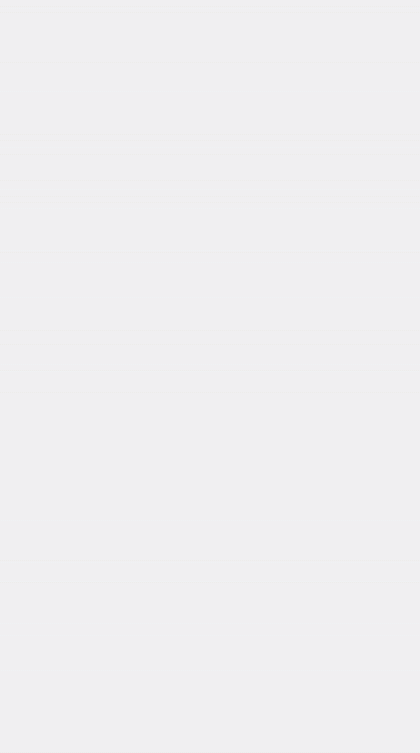
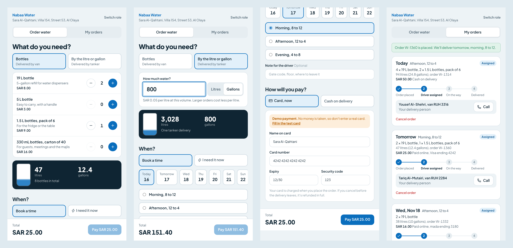
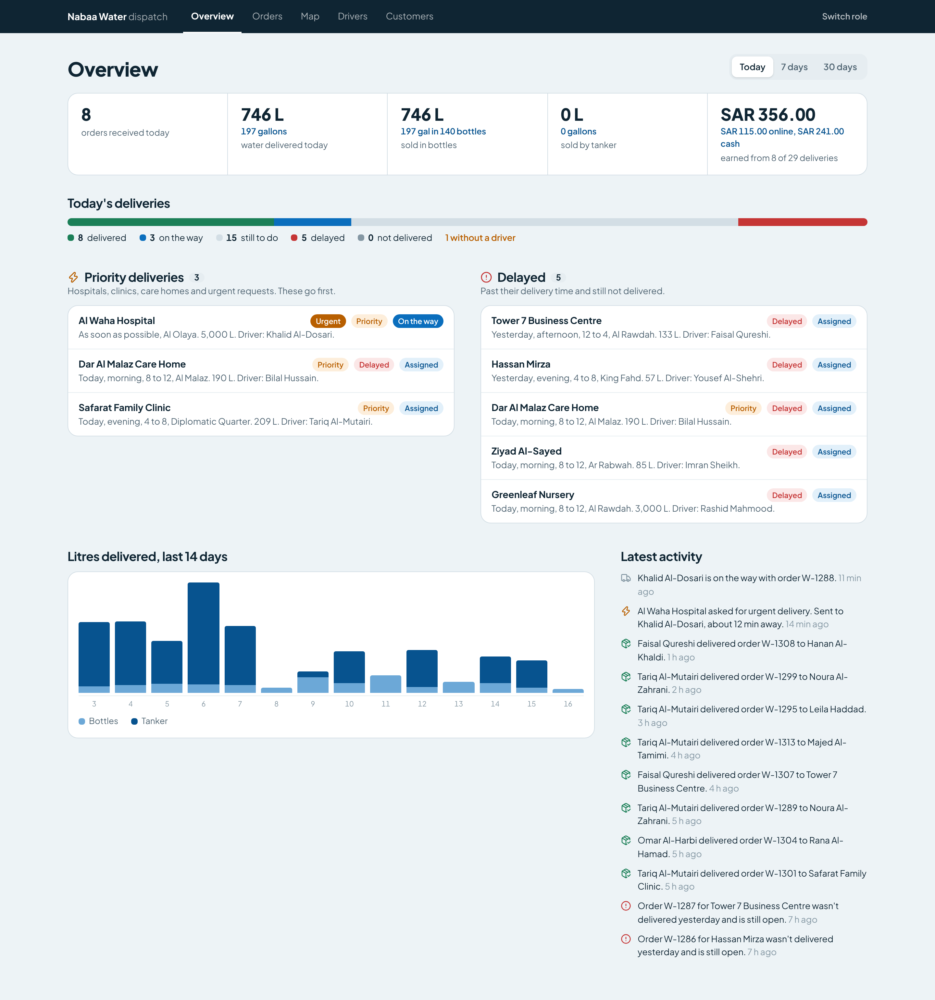
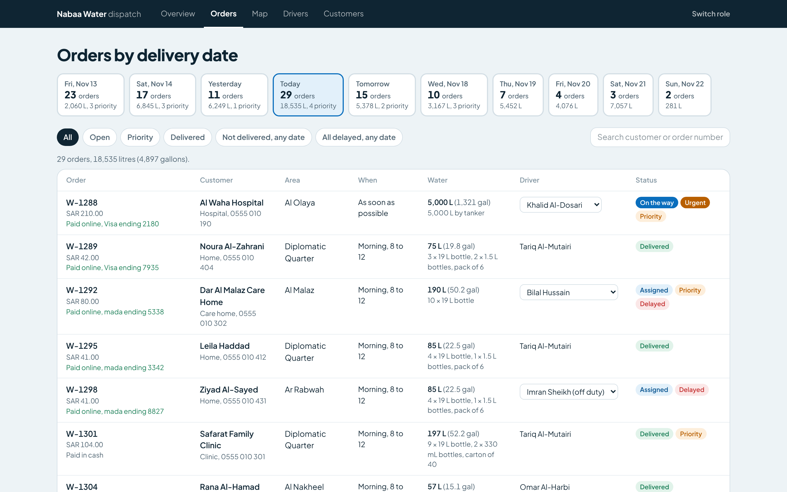
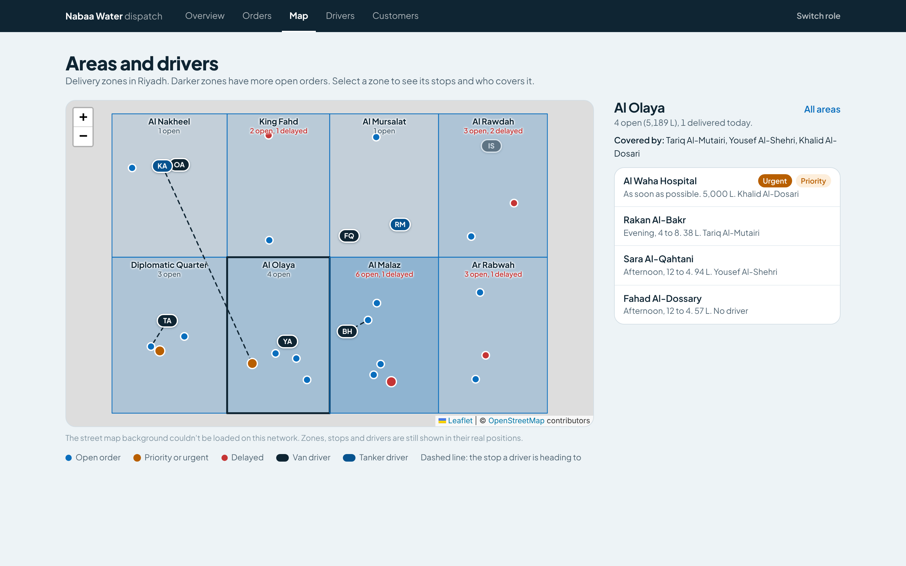
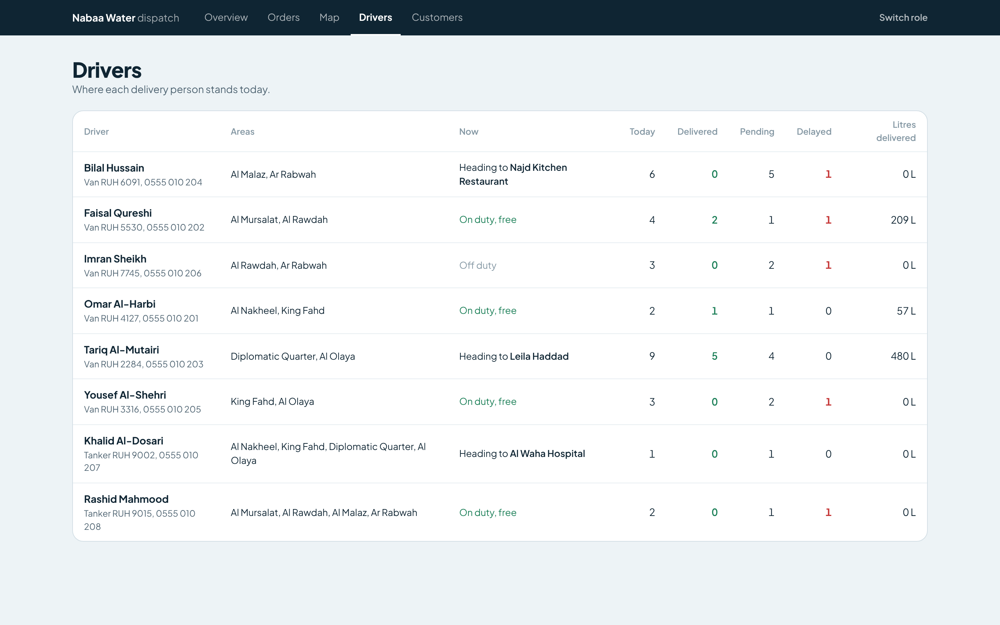
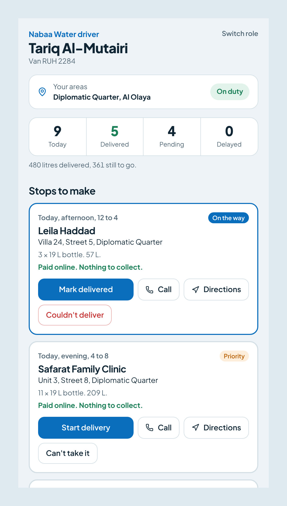
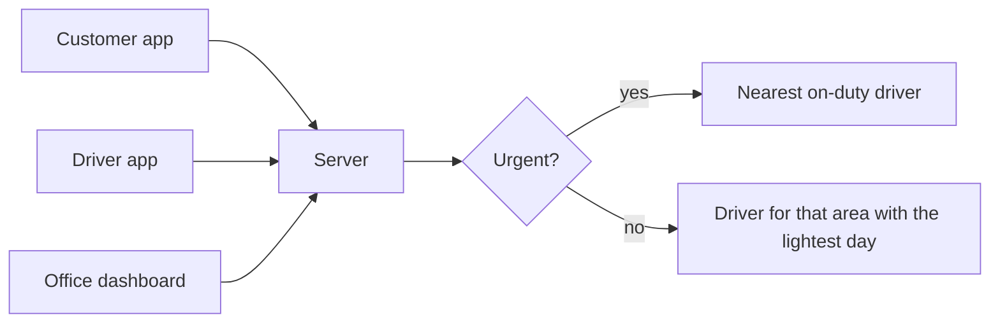

# Water Delivery System

**Online ordering, dispatch and a driver app for a water delivery business, in one system.**

*Above: a customer adds bottles, taps "I need it now", sees the delivery people on duty nearby, pays by card and the order goes to the nearest one.*

---

## The problem

Most water delivery businesses run on phone calls, chat messages and a notebook. Orders get missed, nobody knows how much water went out this week, urgent calls from a hospital sit in the same queue as everything else, and the office can't see which driver is where or which deliveries are running late.

## What this does

### For customers
- **Order the way they think about water:** by the bottle (19 L, 5 L, packs), or in bulk by the litre or gallon for a tanker. The total shows in litres, gallons and bottle count as they build the order.
- **Book delivery to the door:** pick a date and a morning, afternoon or evening slot, up to 30 days ahead.
- **Get it urgently:** see the delivery people on duty nearby with distance and arrival time, call them, or send the order straight to one.
- **Pay online or in cash:** by card when ordering, or cash on delivery. A paid order cancelled before it leaves is refunded automatically.
- **Track it:** placed, driver assigned, on the way, delivered. Call the driver or cancel before it leaves.

### For the office
- **The numbers:** orders received, litres delivered in total, in bottles and by tanker (with gallons), and revenue split into online and cash payments, for today, 7 days or 30 days.
- **Priority deliveries:** hospitals, clinics and care homes are flagged automatically and listed first, with urgent requests.
- **Delayed deliveries:** anything past its time slot and still not delivered.

- **Deliveries by date:** every day's orders with payment status, filters, search, one-click reassignment to another driver, and refunds for paid orders that couldn't be delivered.

- **Areas and drivers on the map:** delivery zones in Riyadh on a street map (OpenStreetMap), with open orders in each zone, each stop, and where every driver is and where they're heading.

- **Driver performance:** today's total, delivered, pending and delayed for each driver.

### For delivery people
- Their own sign-in with their assigned areas and today's count: total stops, delivered, pending and delayed.
- Stops listed in working order: urgent first, then priority customers, then by time slot.
- Each stop shows whether to collect cash or that it's already paid online, with a Directions link.
- Start delivery, mark delivered, report a problem, or call the customer. An urgent order a driver can't take passes to the next nearest driver automatically.

## How it works

Bottle orders go to van drivers and bulk orders to tanker drivers. Each kind of user only sees what is theirs: customers their own orders, drivers their own stops.

## Built with

Node.js and TypeScript (Express, SQLite), React and Tailwind, Leaflet with OpenStreetMap, Docker. Covered by automated tests for pricing, unit conversion, booking rules, urgent matching, payments and refunds, driver actions and access control.

## About this demo

The company ("Nabaa Water") and the people are fictional. Card payments run in test mode: no money moves, and going live means connecting a payment gateway such as Moyasar, HyperPay or Tap with the business's merchant account. Driver positions are simulated; a production version takes GPS from the driver's phone. The map screenshot above was captured without the street background, which appears when the app is online.

## Try it or see the code

- **Live demo:** sign in as a customer, a hospital, a driver or the office. Ask me for the link.
- **Source code:** kept private. I'm happy to walk through it on a call or give a client read access for review.

---

© 2026 Muzamil. All rights reserved.
